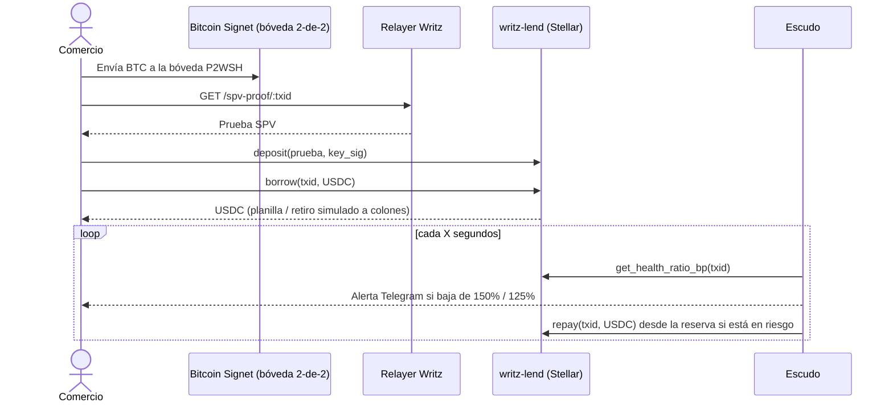

# Caja Tica + Escudo

> Usá tu Bitcoin sin tener que soltarlo. Préstamos en USDC sobre Stellar con BTC en una bóveda de [Writz](https://writz.xyz), y un Escudo que te avisa y abona antes de una liquidación.

_Pura Vida Ideathon | Build on Stellar (APEX). Esqueleto: Josué completa la versión final._

## Problema
_(Josué: evidencia del problema en Costa Rica)_

## Qué cumple
- [ ] Usa Writz de verdad en testnet (`deposit`, `borrow`, `repay`, `get_health_ratio_bp`, `get_position`)
- [ ] Transacciones con enlace a Stellar Expert
- [ ] Pruebas automáticas (≥ 8) + CI en verde
- [ ] Escudo: alertas Telegram + abono automático + "Simular caída"
- [ ] Web responsive según el boceto
- [ ] Commits del equipo durante el evento
- [ ] Pitch 3 min + demo 2 min
- [ ] Nota legal (no es inversión, Ley 10.961 / SUGEF)

## Diagrama de transacciones


## Estructura
| Carpeta | Dueño |
|---|---|
| `/writz`, `/contracts`, `/tests` | José |
| `/web` | Juliana |
| `/escudo` | Raúl |
| `/docs`, README | Josué |

## Correr
```bash
npm install
cp .env.example .env   # llenar llaves (nunca subir .env)
npm test               # pruebas
LIVE=1 npm test        # + pruebas contra testnet
npm run leer           # estado del protocolo y del préstamo
```
