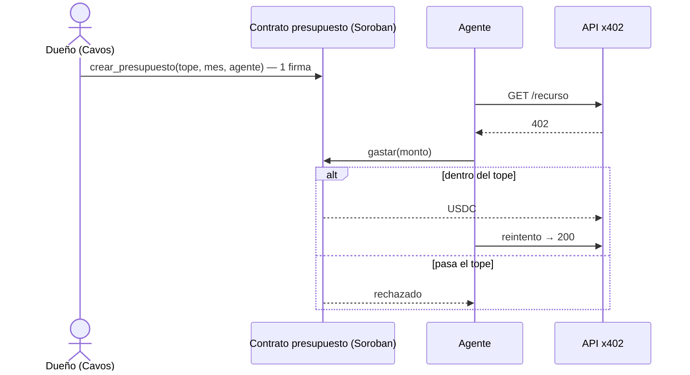

# QuickChain: presupuesto con tope para agentes de IA (Stellar + x402)

> Firmás una vez al mes un tope en USDC. Tu agente de IA paga APIs x402 en Stellar solo, sin pedirte firma en cada llamada, y nunca gasta más del tope.

_Pura Vida Ideathon | Build on Stellar (entrega en APEX). Prototipo en testnet._

**Video (3 min pitch + 2 min demo):** TODO

> **Nota legal.** Prototipo en testnet. No es una inversión, no promete rendimientos y no está libre de riesgo (errores de software, de la red o del proveedor de la API). No es una entidad regulada por SUGEF (Ley 10.961).

## Problema
Con x402, el esquema `exact` pide **una firma y una transacción por cada llamada**. Para un agente que hace muchas llamadas eso es lento, y darle al agente una llave sin límite es peligroso.
- La comunidad de x402 lo reporta: cada request necesita una firma nueva y un settlement por llamada. https://github.com/x402-foundation/x402/issues/946
- En Stellar, el facilitador público solo soporta `exact`. https://developers.stellar.org/docs/build/agentic-payments/x402/built-on-stellar

## Solución
1. El dueño del agente entra con **Cavos** (email, sin seed phrase). https://docs.cavos.xyz/
2. Firma **una vez** un presupuesto mensual en USDC: tope, mes y qué agente puede gastar.
3. El agente llama a una API, recibe un **402**, paga desde el presupuesto y repite la llamada. Sin firmas por llamada.
4. El **contrato Soroban rechaza** cualquier pago que pase el tope o el mes.
5. El mes siguiente, una firma lo renueva. Se puede cancelar cuando quieras.

## Quién paga y cuánto
- **El dueño del agente** paga a QuickChain **1% de lo que el agente gasta** por el presupuesto.
- **Sin mensualidad.** Si el agente no gasta, no pagás nada.

## Por qué sirve a los dos lados
- **Dueño del agente:** control (tope que el contrato hace cumplir), una firma al mes, cancelar en cualquier momento.
- **Proveedor de la API:** cobra con x402 normal en USDC; no tiene que cambiar nada.

## Siguiente paso (no en este prototipo)
Suscripciones del lado del vendedor (el proveedor ofrece planes).

## Transacciones demo (testnet)
| Paso | Enlace |
|---|---|
| `crear_presupuesto` | TODO: enlace a Stellar Expert |
| `gastar` (llamadas 1..n) | TODO: enlace a Stellar Expert |
| `gastar` rechazado por tope | TODO: enlace a Stellar Expert |
| `renovar` | TODO: enlace a Stellar Expert |
| `cancelar` | TODO: enlace a Stellar Expert |

## Tareas
Ver [TAREAS.md](TAREAS.md).

## Licencia
Ver [LICENSE](LICENSE).
