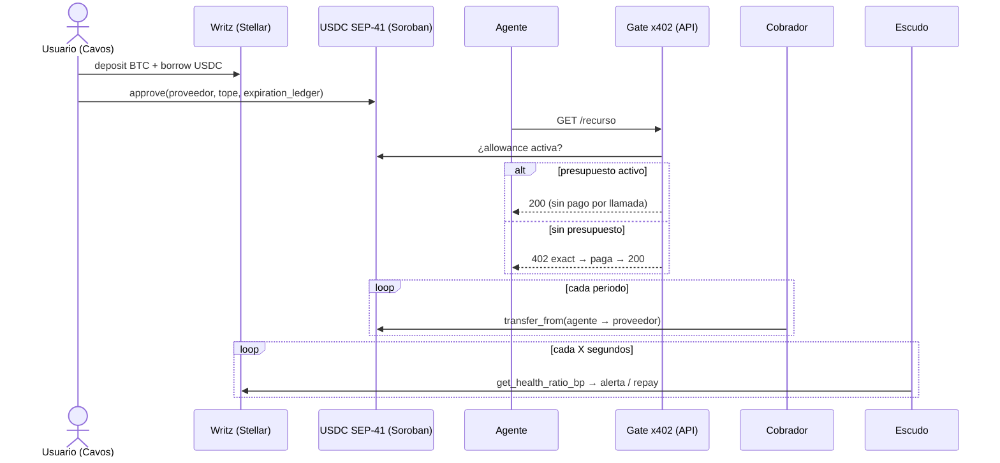

# Presupuesto prepagado para agentes de IA sobre Stellar con x402

> Tu agente de IA paga APIs en USDC sobre Stellar con un presupuesto que autorizás una sola vez, financiado con tu Bitcoin vía [Writz](https://writz.xyz), sin tarjeta y sin seed phrase.

_Pura Vida Ideathon | Build on Stellar (entrega en APEX), track Genesis. Todo corre en testnet. El proyecto todavía no tiene nombre._

**Demo en vivo (versión anterior, Escudo):** [josedanielm0202-droid.github.io/caja-tica-escudo](https://josedanielm0202-droid.github.io/caja-tica-escudo/)

**Video del pitch (3 min) + demo (2 min):** TODO: link al video

> **Nota legal.** Esto es un prototipo en testnet. No es una inversión, no promete rendimientos y no está libre de riesgo: si el precio del BTC cae, el préstamo de Writz que respalda el presupuesto se puede liquidar. No es una entidad regulada por SUGEF (Ley 10.961). El retiro a colones es simulado.

## Problema
Con x402 un agente de IA paga cada llamada a una API. Con el esquema `exact`, **cada llamada es una firma nueva, una verificación del facilitador y una transacción on-chain**.
- La propia comunidad de x402 lo propuso arreglar: *"Every request needs a fresh … signature… Requires a settlement transaction per call"* (1000 llamadas = 1000 firmas y 1000 tx). https://github.com/x402-foundation/x402/issues/946
- The Graph pidió settlement por sesión para los loops de queries de agentes. https://github.com/graphprotocol/graph-client/issues/1031
- x402 ya agregó `batch-settlement` *"for high-volume or repeated micropayments"*. https://docs.x402.org/schemes/overview
- Stripe/Tempo (MPP) sacaron "sessions": *"authorize once"*. https://stripe.com/blog/machine-payments-protocol , https://tempo.xyz/blog/mpp-sessions/
- OKX tiene en producción el esquema x402 `period` (suscripción), **solo en EVM**. https://web3.okx.com/onchainos/dev-docs/payments/core-concept
- **En Stellar no existe:** el facilitador público (OpenZeppelin) solo soporta `exact`. https://developers.stellar.org/docs/build/agentic-payments/x402/built-on-stellar

Del lado del proveedor, el software se cobra mayormente con modelo híbrido (suscripción + uso): 61% de los SaaS usaba algún pricing por uso y 46% era híbrido (OpenView 2023, dato de SaaS en general, no de APIs para agentes). https://techcrunch.com/2023/02/02/usage-based-pricing-is-rising-but-not-replacing-other-models/

**Tamaño, con honestidad:** x402 lleva ~195M de tx y ~US$42M liquidados (https://agenteconomy.to/x402), pero en los últimos 30 días el volumen cayó ~57% (https://402radar.io/stats) y el volumen orgánico ronda US$710k/mes con 92 vendedores orgánicos (https://x402stats.io/llms-full.txt). Es un mercado real, chico y temprano.

**Entrevistas a usuarios:** TODO (pendientes). Devs y proveedores de APIs que hoy pagan o cobran por llamada; vamos a poner aquí cuántas hicimos y qué dijeron.

## La solución
El usuario autoriza una vez un **presupuesto on-chain con tope y vencimiento** para su agente. Mientras el presupuesto esté activo, la API lo deja pasar sin pagar cada llamada; si no, cobra por llamada con x402 normal.

1. **Login con [Cavos](https://docs.cavos.xyz/)**: email, wallet embebida, sin seed phrase ni Freighter.
2. **Writz**: bloqueás BTC y pedís USDC prestado en Stellar testnet (`writz/client.ts`).
3. **Presupuesto**: `approve` del token USDC (SEP-41) en Soroban al proveedor de la API, con tope y `expiration_ledger`.
4. **Gate x402** (`escudo/riesgo-server.ts`): si el agente tiene presupuesto activo → 200 sin pago por llamada; si no → 402 `exact`.
5. **Cobrador (keeper)**: cobra cada periodo con `transfer_from`, por fuera del facilitador (que solo hace `exact`). Si el keeper falla, la suscripción vence y el gate vuelve a pedir pago por llamada (falla de forma segura).
6. **Escudo**: vigila la salud del préstamo de Writz (en bp), avisa por Telegram y abona automáticamente desde una reserva.

### ¿Por qué Stellar?
x402 en Stellar ya existe con USDC SEP-41 y fees patrocinados por el facilitador (https://developers.stellar.org/docs/build/agentic-payments/x402), Soroban permite `approve` con vencimiento por ledger, y Writz (BTC → USDC sin puentes) solo existe en Stellar (https://github.com/WritzProtocol/writz).

### Competencia
OKX `period` (EVM), MPP sessions (Tempo), y en Stellar: Rail402 (`exact`/`upto`, sin suscripción, https://github.com/tolgayayci/rail402), ApiCharge (pago por llamada y streaming, https://apicharge.com) y Subs (suscripciones Soroban sin x402, https://stellar.subsprotocol.com). No encontramos uno en Stellar que combine suscripción con gate x402, pero eso no prueba que no exista. No es una idea nueva: es llevar a Soroban algo que ya funciona en EVM.

## Diagrama


## Transacciones reales (testnet)
Detalle completo en [`docs/transacciones.md`](docs/transacciones.md). Las del flujo nuevo (approve, 3 pagadas, 10 gratis, cobro) se agregan en la tarea T10.

| Paso | Enlace |
|---|---|
| BTC a la bóveda (Signet) | [646871d2…b9ae](https://mempool.space/signet/tx/646871d28e40eafc7e72a4d8bea5c0d86f5c2e99a8f72be553993d5804c9b9ae) |
| `deposit` (SPV + key_sig) | [ef6d4c49…80ce](https://stellar.expert/explorer/testnet/tx/ef6d4c49ec9b453be3023490c2dc2cd0e92a6bb3c80fec813591a9fc05d880ce) |
| `borrow` 3 USDC | [332b30a1…e6fe](https://stellar.expert/explorer/testnet/tx/332b30a127d21b3db6d2be0d35514510f06a562a9db98126614e5fbd6116e6fe) |
| `repay` 1 USDC desde la reserva (abono del Escudo) | [de0fe085…b179](https://stellar.expert/explorer/testnet/tx/de0fe085870c3403356dfabd74546fbeb423a73253d70d1fa9521e126585b179) |
| `approve` presupuesto | TODO (T1) |
| 3 llamadas pagadas x402 | TODO (T4) |
| Cobro del periodo (`transfer_from`) | TODO (T2) |

## Estado
- [x] Writz real en testnet (`deposit`, `borrow`, `repay`, `get_health_ratio_bp`) vía `writz/client.ts`
- [x] Escudo: Telegram + abono automático ([`escudo/`](escudo/README.md))
- [x] Gate x402 `exact` en Stellar testnet (`escudo/riesgo-server.ts`)
- [ ] Presupuesto on-chain (approve con tope y vencimiento) — T1
- [ ] Cobrador — T2 · Gate con suscripción — T3 · Agente demo — T4
- [ ] Login con Cavos — T5 · Panel — T6 · Writz fondea el presupuesto — T7
- [ ] Pitch + video — T9

Plan de trabajo: [`TAREAS.md`](TAREAS.md).

## Correr
```bash
npm install
cp .env.example .env   # llenar llaves (nunca subir .env)
npm test               # pruebas
LIVE=1 npm test        # + pruebas contra testnet
npm run leer           # estado del protocolo y del préstamo
npm run escudo         # bot del Escudo (ver escudo/README.md)
npm run escudo:riesgo  # gate x402
cd web && npm install && npm run dev   # app web (ver web/README.md)
```

## Equipo
TODO: nombres y handles como quieran salir.

## Licencia
[MIT](LICENSE)
